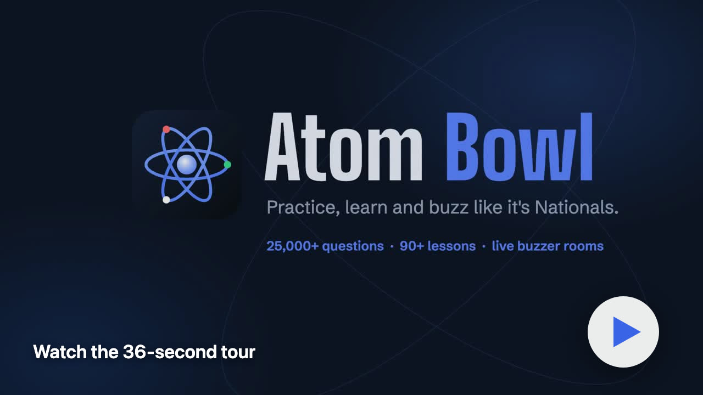

# Atom Bowl Docs

The documentation site for [Atom Bowl](https://atombowl.web.app). Plain HTML and CSS with no build step, hosted on Cloudflare Pages.

Everything served lives in `public/`. Edit the HTML files there directly.

## Preview locally

```bash
python3 -m http.server 8080 --directory public
```

Cloudflare Pages serves `practice.html` at `/practice`. A plain static server needs `/practice.html`.

## Deploy on Cloudflare Pages

In the Cloudflare dashboard go to Workers & Pages, then Create, then Pages, then Connect to Git, and pick this repo. Use:

| Setting | Value |
| --- | --- |
| Production branch | `main` |
| Framework preset | None |
| Build command | leave empty |
| Build output directory | `public` |

Every push to `main` deploys, and every pull request gets a preview URL.

## Contributing

Open a pull request. Never push to `main`. See [CONTRIBUTING.md](CONTRIBUTING.md).

## Tour

<p align="center">
  <a href="https://github.com/shankar-sachin/atombowl-docs/blob/main/public/explainer.mp4">
    
  </a>
</p>
